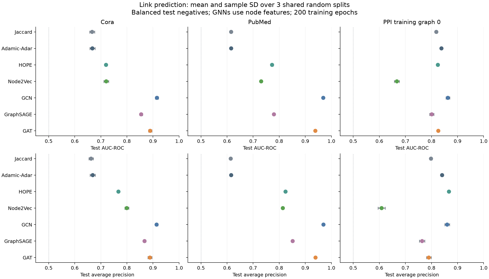
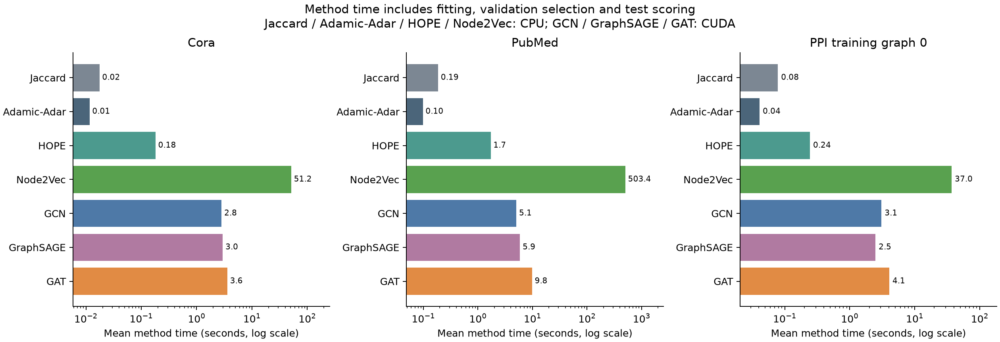
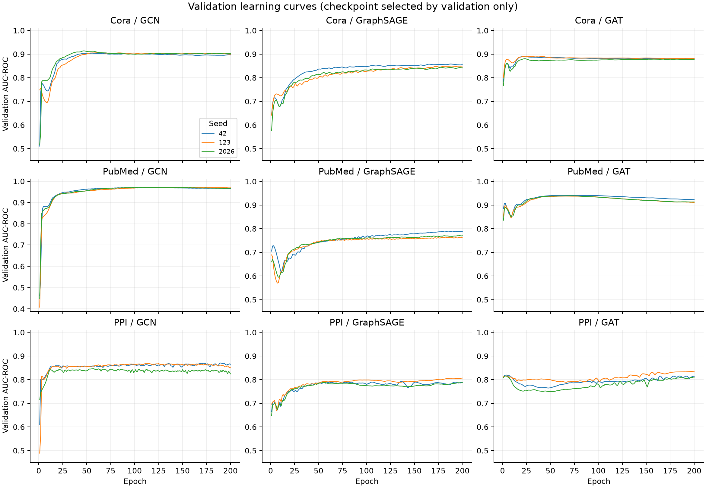

# Link prediction benchmark - 23 October 2026

All 63 method cases completed successfully: seven methods, three graphs and three seeds (42, 123, 2026). GNNs trained for 200 epochs per case. Checkpoints and embedding candidates were selected by validation AUC-ROC, breaking ties with validation AP. This compares these implementations under a shared random-edge protocol; it is not a state-of-the-art claim.

## Results

Values are mean +/- sample standard deviation over three seeded edge splits. The splits overlap within each graph; this measures seed sensitivity, not independent graph replication or statistical significance. AP means average precision on balanced sampled positives/non-edges.

| Graph | Highest mean AUC | AUC | Highest mean AP | AP |
| --- | --- | --- | --- | --- |
| Cora | GCN | 0.9151 +/- 0.0064 | GCN | 0.9138 +/- 0.0050 |
| PubMed | GCN | 0.9690 +/- 0.0017 | GCN | 0.9697 +/- 0.0020 |
| PPI graph 0 | GCN | 0.8628 +/- 0.0071 | HOPE | 0.8669 +/- 0.0017 |

These are descriptive test rankings. Test results were not used to change this benchmark.

### Interpretation and priorities

GCN has the highest mean AUC on all three selected graphs, while HOPE has the highest mean AP on PPI. Continue from GCN as the accuracy baseline under this protocol; retain inexpensive structural methods as speed/quality controls. Prioritize attribute-only and degree-product controls, Node2Vec decoder experiments, and validation-based GNN training settings before adding more complex architectures. Expand graph coverage and ranking evaluation before drawing broader conclusions.

### Cora

| Method | Test AUC-ROC | Test AP | Method seconds |
| --- | --- | --- | --- |
| Jaccard | 0.6666 +/- 0.0097 | 0.6626 +/- 0.0086 | 0.02 +/- 0.00 |
| Adamic-Adar | 0.6676 +/- 0.0100 | 0.6689 +/- 0.0101 | 0.01 +/- 0.00 |
| HOPE | 0.7200 +/- 0.0030 | 0.7675 +/- 0.0036 | 0.18 +/- 0.01 |
| Node2Vec | 0.7208 +/- 0.0091 | 0.7994 +/- 0.0080 | 51.22 +/- 0.39 |
| GCN | 0.9151 +/- 0.0064 | 0.9138 +/- 0.0050 | 2.82 +/- 0.05 |
| GraphSAGE | 0.8546 +/- 0.0059 | 0.8676 +/- 0.0046 | 2.97 +/- 0.03 |
| GAT | 0.8892 +/- 0.0066 | 0.8882 +/- 0.0079 | 3.59 +/- 0.06 |

### PubMed

| Method | Test AUC-ROC | Test AP | Method seconds |
| --- | --- | --- | --- |
| Jaccard | 0.6157 +/- 0.0010 | 0.6142 +/- 0.0012 | 0.19 +/- 0.11 |
| Adamic-Adar | 0.6158 +/- 0.0009 | 0.6159 +/- 0.0009 | 0.10 +/- 0.02 |
| HOPE | 0.7726 +/- 0.0041 | 0.8243 +/- 0.0021 | 1.71 +/- 0.09 |
| Node2Vec | 0.7309 +/- 0.0037 | 0.8139 +/- 0.0020 | 503.43 +/- 36.25 |
| GCN | 0.9690 +/- 0.0017 | 0.9697 +/- 0.0020 | 5.07 +/- 0.05 |
| GraphSAGE | 0.7798 +/- 0.0035 | 0.8516 +/- 0.0016 | 5.90 +/- 0.03 |
| GAT | 0.9386 +/- 0.0019 | 0.9392 +/- 0.0027 | 9.81 +/- 0.08 |

### PPI training graph 0

| Method | Test AUC-ROC | Test AP | Method seconds |
| --- | --- | --- | --- |
| Jaccard | 0.8185 +/- 0.0038 | 0.7981 +/- 0.0044 | 0.08 +/- 0.02 |
| Adamic-Adar | 0.8381 +/- 0.0029 | 0.8407 +/- 0.0042 | 0.04 +/- 0.00 |
| HOPE | 0.8244 +/- 0.0033 | 0.8669 +/- 0.0017 | 0.24 +/- 0.00 |
| Node2Vec | 0.6673 +/- 0.0097 | 0.6087 +/- 0.0137 | 36.96 +/- 4.34 |
| GCN | 0.8628 +/- 0.0071 | 0.8601 +/- 0.0093 | 3.08 +/- 0.06 |
| GraphSAGE | 0.8011 +/- 0.0079 | 0.7640 +/- 0.0103 | 2.49 +/- 0.02 |
| GAT | 0.8261 +/- 0.0040 | 0.7897 +/- 0.0090 | 4.06 +/- 0.02 |

## Protocol and scope

| Graph | Nodes | Unique edges | Features | Train / validation / test positives |
| --- | --- | --- | --- | --- |
| Cora | 2708 | 5278 | 1433 | 3696 / 527 / 1055 |
| PubMed | 19717 | 44324 | 500 | 31028 / 4432 / 8864 |
| PPI | 1767 | 16159 | 50 | 11313 / 1615 / 3231 |

- Simple, unweighted, undirected graphs with isolated nodes retained; approximately 70/10/20% positive edges.
- Unique 1:1 negative samples, disjoint across all partitions and excluding every observed positive. Unobserved links are assumed negative.
- Identical training graph and evaluation pairs across methods for each graph/seed. Validation/test edges are absent from GNN message passing.
- GNNs additionally receive node attributes transformed by PyG NormalizeFeatures; the other methods use topology only. PPI is training graph index 0, not the full collection or an inductive evaluation.
- Embedding dimension 64. HOPE uses 32 source/32 target factors, sparse Katz decomposition, and beta 0.01 or 0.005 selected on validation.
- Node2Vec uses p=q=1, 20 walks per node, length 20, windows 5/10, one worker, batch_words=4, five Skip-Gram epochs and five noise words per context.
- GNNs use two encoder layers, hidden width 32, output width 64, dropout 0.3, Adam at 0.01, and a symmetric product/absolute-difference MLP decoder. GAT has eight first-layer heads; parameter counts are not matched.
- GNN supervision and message passing share positive training edges. Training negatives remain fixed over epochs.

## Runtime and memory

CPU methods used an Intel i5-11400H and three CPU threads (Node2Vec one worker). GNNs used an RTX 3050 Ti Laptop GPU, 4 GiB, CUDA 13.0 and PyTorch 2.14.1+cu130. System RAM is approximately 16 GiB. Benchmark cases ran serially in separate processes on Windows, on AC power.

Method time includes fitting, validation selection and test scoring; loading, imports, saving and plotting are excluded. Two embedding candidates and 200 GNN epochs represent different computation budgets. Whole-process wall time and memory are in the raw CSV. RSS was sampled once per second; PyTorch GPU peaks exclude context/driver allocations. Environment preparation overlapped the CPU stage. Clocks and other local applications were not controlled.

Sum of case wall times: 43.7 minutes, excluding setup and probes. Maximum sampled process RSS: 1693 MiB; maximum PyTorch GPU allocation: 465 MiB.

## Improvements investigated on validation only

The following experiments do not replace the main benchmark. They use training/validation labels only and never produce test scores. Repeated validation inspection can overfit; generalization gains need a new prespecified evaluation.

### Node2Vec batching

| Graph | Batch 4 sec | Batch 10000 sec | Approx. time ratio | Batch 4 val AUC | Batch 10000 val AUC |
| --- | --- | --- | --- | --- | --- |
| Cora | 51.2 | 30.6 | 1.7x | 0.7149 | 0.7116 |
| PubMed | 503.4 | 344.4 | 1.5x | 0.7255 | 0.7259 |
| PPI | 37.0 | 32.6 | 1.1x | 0.6642 | 0.6629 |

Both use one worker and two window candidates. Original time also includes test scoring; probe time covers fitting and validation only, so the ratio is approximate. Larger batches change the optimization trajectory as well as overhead. Expose batching as a parameter and verify quality before changing the default. Also generate random walks once per graph/seed and reuse the corpus across window candidates: the current code regenerates the same seeded walks for each window. [Gensim describes batch_words as the batch target passed to worker/Cython routines.](https://radimrehurek.com/gensim/models/word2vec.html)

### Node2Vec decoder

| Graph | Dot val AUC | Cosine val AUC | Learned decoder val AUC | Added sec |
| --- | --- | --- | --- | --- |
| Cora | 0.7149 | 0.7402 | 0.7972 | 0.04 |
| PubMed | 0.7255 | 0.7262 | 0.7291 | 0.31 |
| PPI | 0.6642 | 0.7915 | 0.7915 | 0.11 |

The learned decoder is a StandardScaler and logistic regression (C=1) on product and absolute-difference pair features, fitted on training labels. It reuses the original validation-selected embeddings. This adds supervised link information, as the GNN decoder does, and is a distinct method. These trials were added after preliminary validation review: [exploration plan](decoder-exploration-plan.json).

### Inexpensive controls

| Graph | Adamic-Adar | Common neighbors | Resource Allocation | Degree product | Feature cosine |
| --- | --- | --- | --- | --- | --- |
| Cora | 0.6600 | 0.6599 | 0.6600 | 0.6142 | 0.8055 |
| PubMed | 0.6163 | 0.6163 | 0.6163 | 0.7138 | 0.8897 |
| PPI | 0.8369 | 0.8342 | 0.8354 | 0.8852 | 0.4697 |

Values are mean validation AUC, not test results. Feature cosine is an attribute-only control. Add a learned feature-only MLP and GNN feature ablations to separate attribute gains from message passing. [Graph diagnostics](graph-diagnostics.csv) record isolated nodes, components and common-neighbor coverage.

### GNN training

| Graph | Model | Best epoch median (range) | Final val AUC drop from best |
| --- | --- | --- | --- |
| Cora | GCN | 51 (47-63) | 0.0079 |
| Cora | GraphSAGE | 188 (178-189) | 0.0031 |
| Cora | GAT | 23 (22-34) | 0.0069 |
| PubMed | GCN | 115 (106-138) | 0.0037 |
| PubMed | GraphSAGE | 193 (182-197) | 0.0004 |
| PubMed | GAT | 67 (66-70) | 0.0238 |
| PPI | GCN | 115 (57-190) | 0.0149 |
| PPI | GraphSAGE | 137 (56-200) | 0.0019 |
| PPI | GAT | 4 (3-200) | 0.0035 |

Use validation early stopping beyond a plateau. Where checkpoints remain near epoch 200, test a larger budget under a new protocol. Compare learning rate, dropout and width with equal validation budgets. Investigate resampled training negatives and disjoint message-passing/supervision edges; [PyG supports disjoint_train_ratio](https://pytorch-geometric.readthedocs.io/en/latest/generated/torch_geometric.transforms.RandomLinkSplit.html). None guarantees an improvement without testing.

### Stronger evaluation

Add multiple PPI graphs and a separately defined held-out-graph evaluation. For recommendation-style use, preregister harder/larger candidate pools and Hits@K/MRR; temporal splits require suitable data. [OGB illustrates ranking metrics and temporal/domain splits](https://ogb.stanford.edu/docs/linkprop/). Balanced AP here does not estimate precision among all possible graph pairs.

## Verification and artifacts

All 63 prediction files reproduce reported AUC/AP. Nine graph/seed groups have identical split dictionaries, test pairs/labels and feature hashes across methods. All six edge partitions are unique and mutually disjoint. Nine sparse HOPE eigenpair checks have maximum relative residual 4.60e-15. All 27 GNN checkpoints were reloaded on CPU and replayed; maximum absolute difference from saved CUDA predictions was 4.26e-06.

The unit suite passed 21 tests, and Ruff passed. Small-graph tests verify full/truncated sparse HOPE against dense Katz and forbid densification on its sparse path. Seeds and disabled TF32 reduce variation; strict deterministic CUDA algorithms are not enabled. [PyTorch does not guarantee identical results across devices, versions or platforms.](https://docs.pytorch.org/docs/2.14/notes/randomness.html)

Algorithm-source SHA-256: **a4d6b5c361c32bc820a82f3ae5490bd8febef30dffe2df320e71f8f081a89dd4**.

Artifacts: [raw results](raw-results.csv), [summary](summary.csv), [training diagnostics](training-diagnostics.csv), [split audit](audit.json), [numerical checks](numerical-checks.json), [protocol](protocol.json), [source hashes](source-files-sha256.json), [hardware](hardware.json), [versions](environment-versions.json). Exact pairs, logs, arrays and checkpoints remain locally under ignored reports/full-benchmark/.

## Reproduce

CPU-only run, using a new output directory:

~~~powershell
uv sync --locked --extra embeddings --extra gnn --extra benchmark
.venv\Scripts\python.exe benchmark.py --device cpu --output reports/reproduction-cpu
~~~

The recorded run used the CPU environment for four methods and a separate CUDA environment for GNNs:

~~~powershell
uv venv --python 3.11 --no-project .venv-benchmark
uv pip install --python .venv-benchmark\Scripts\python.exe --index-url https://download.pytorch.org/whl/cu130 "torch==2.14.1"
uv pip install --python .venv-benchmark\Scripts\python.exe --no-deps -r benchmarks/2026-10-23/environment-requirements-without-torch.txt -e .
uv pip check --python .venv-benchmark\Scripts\python.exe
.venv\Scripts\python.exe benchmark.py --stage cpu --device cuda --output reports/reproduction-cuda
.venv\Scripts\python.exe benchmark.py --stage gnn --device cuda --python .venv-benchmark\Scripts\python.exe --output reports/reproduction-cuda --resume
~~~

In the CPU stage, the device flag reserves the GNN protocol for the next stage; the four methods still compute on CPU. Resume reuses successful cases with matching protocol/source hash. The environment requirement file includes Windows packages; other platforms may need a newly resolved environment.

Analysis and validation-probe scripts are retained under [scripts/](scripts/). No remote repository was created or updated.
