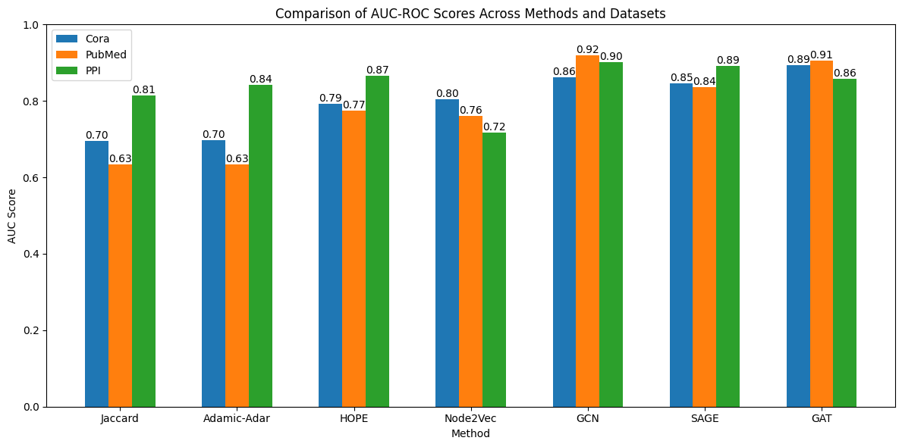
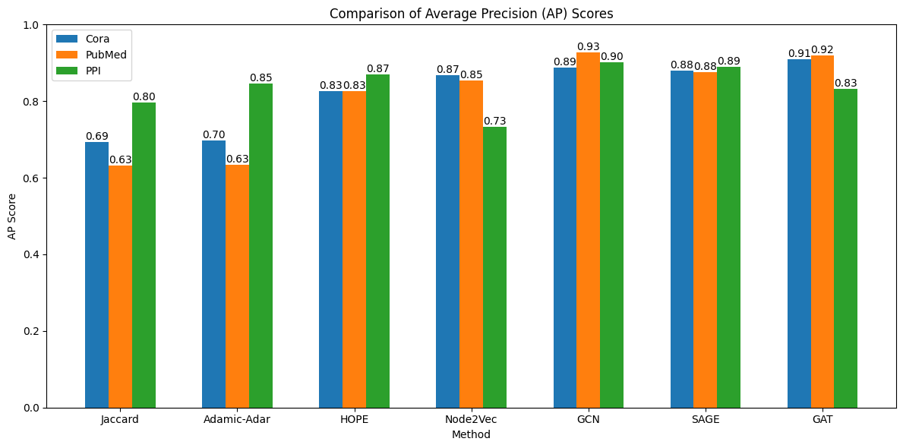
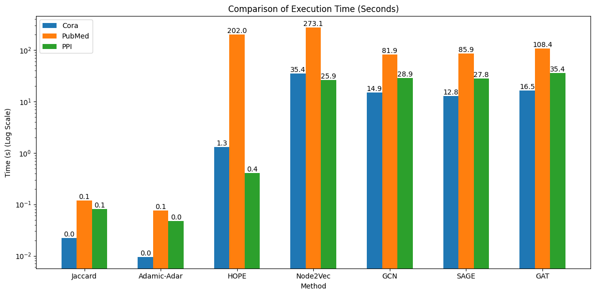

# Historical experiment outputs

These figures came from the original university project. The original console log is kept locally and excluded from Git.

They are retained as an archive. They have not been reproduced with the current code and should not be compared directly with its reports.

The original script used different edge splits for classical methods and GNNs, selected embedding hyperparameters by test AUC, and used an incorrect HOPE singular-value scaling. The current implementation changes these parts of the evaluation. Original source snapshots are preserved locally in the ignored backup directory.
